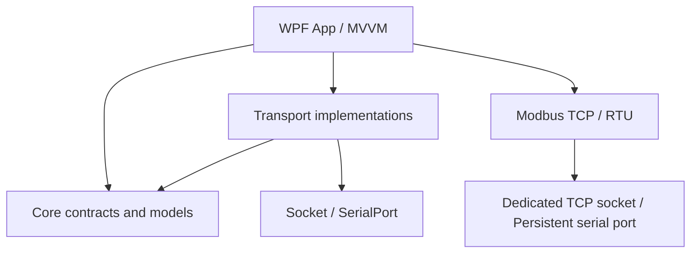
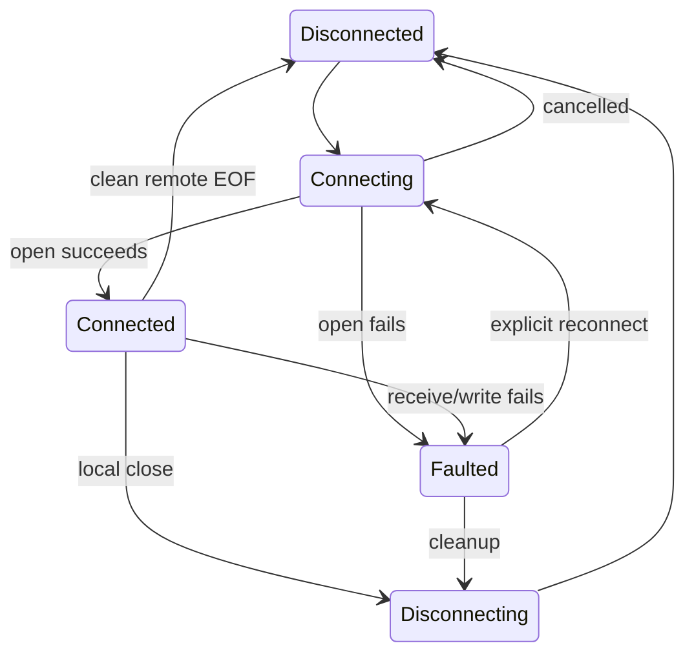

# 架构与扩展

## 依赖方向

`Core` 不引用 WPF、串口驱动或 socket。`Transports` 负责 I/O 和设备生命周期。`App` 负责界面、会话组装、界面层有界事件队列和配置命令。项目规模尚不需要依赖注入框架、消息总线或通用插件宿主；增加这些设施应由实际扩展需求驱动。

## 能力建模

公共 `ICommunicationSession` 只定义状态、连接、断开、统计及生命周期事件，不定义万能 `Send(byte[])`。数据交换由能力接口表达：

- `IStreamSession`：读取片段与有序字节写入。服务端额外需要 peer 选择。
- `IDatagramSession`：每次发送有目标地址，每次接收有独立来源和完整数据报。
- `ICanSession`：标识符、扩展标志、RTR / FD 标志以及帧数据；CAN 硬件实现需要验证标准/扩展 ID 范围、DLC、FD 能力、位速率和硬件时间戳等。当前是扩展契约，不是可用驱动。

`TrafficRecord` 是监控投影，不能用它替代协议级数据模型。CAN 适配时应扩充 Traffic 的结构化元数据/专用视图，不能将标识符和标志丢弃成普通 byte stream。

Modbus 是协议层。`ModbusMasterClient` 复用 FC01/02/03/04/05/06/15/16 请求构造、结果解码和写入回显校验。TCP 每个事务拥有单独的 socket，通过 `ReadExactlyAsync` 拼接 MBAP / PDU，并校验事务 ID、协议 ID 和 unit。RTU 由 `ModbusRtuMaster` 持有持续打开的串口，通过信号量串行化打开、事务和关闭，`ModbusRtuCodec` 负责地址 / PDU / 低字节在前的 CRC16。TCP / RTU 从机共用 `ModbusSlaveProtocol` 和线程安全的 `ModbusRegisterBank`，输入表禁止协议写入；RTU 额外处理地址过滤和广播写入。UI 轮询使用固定请求快照和可取消定时器，表格将实时值与待写入值分开。

`IModbusRtuPort` 是可注入的串口 I/O 边界，用于模拟分片、超时和取消。实际串口在后台 worker 执行带超时的阻塞读写，读取最多等待 25 ms 后检查取消。已知功能码使用长度组帧，未知功能码与残帧通过静默间隔结束；Windows / USB 调度容差至少 20 ms，不承诺高波特率下严格微秒级 t1.5 / t3.5。主机取消、超时、CRC 或地址错误后释放串口，防止无事务号的迟到响应污染下次请求。接收记录在校验前发布，包含完整 CRC 或已收到的残帧。从机停止等待接收 worker 退出并释放端口；广播只允许写功能码，处理后不响应。

## 生命周期与线程

- `SessionBase` 用异步信号量串行化 open/close；每次连接创建独立 lifetime token。调用方的 connect token 只取消建立过程，不会因之后被取消而意外终止已建立连接。
- 主动断开先取消 lifetime，再关闭底层句柄以唤醒接收，等待接收及在途发送退出。重新打开前等待旧写入退出，避免上一代写入访问新句柄。
- 每个会话一个 send gate，多个调用者的写入不交叉。服务端为简单可靠选择会话级 gate；未来高吞吐场景可改为每 peer 一个 gate。
- TCP EOF 是正常断开，不产生空 RX；UDP 零长度数据报是有效 RX。TCP Server 管理自己的 peer 集合、64 客户端上限和独立接收任务，关闭时收拢全部任务。
- 串口驱动对 `BaseStream.ReadAsync` cancellation 支持不一致，所以使用后台 worker + 200 ms `ReadTimeout`，写入超时 1 秒。打开、读取、写入、关闭都从 UI 外调用。驱动级挂死并不能由托管 CancellationToken 强制修复；后续需按真实硬件验证驱动关闭行为。
- 写入错误不自动重试，因为工业协议命令重复执行可能改变设备状态；取消/超时也不意味着设备绝对未收到任何字节。
- 公共事件在后台线程同步发布，订阅者必须快速返回且不能抛异常。当前 UI 订阅只向通道入队。协议解析器不得直接在 UI Dispatcher 上进行设备 I/O。

## UI 与内存

采用轻量 MVVM：ViewModel 保存连接状态和命令，窗口代码仅负责视觉验证错误、自动滚动和关闭流程。用户每次连接创建全新的 transport session；回调携带会话身份，旧生命周期事件不会覆盖新连接状态。

Traffic 使用容量 512 的 DropOldest 通道，溢出显式统计。Dispatcher 100 ms 批量取最多 150 条；DataGrid 开启行/列虚拟化。集合变更逐条通知，不在 `ICollectionView.DeferRefresh` 中修改绑定的 ObservableCollection，避免当前项维护与延迟刷新冲突。窗口最多保留 1,000 条记录和 300 条日志。TCP/Serial 单次读 8 KiB，UDP 最大有效负载 65,507 bytes，避免无限增长。选中详情保留整条数据，列表只格式化前 256 bytes。

监控是可丢弃的呈现层。协议处理、持久化以及计数不能从这个通道反推可靠业务数据。真正无损历史记录应在 transport/protocol 与 UI 分流处增加独立 sink，并明确磁盘背压/溢出策略。

连接配置使用不可变 `ConnectionProfile` 快照，ViewModel 编辑时替换快照。连接期间禁用参数编辑；周期发送固定启动时的 session/peer/内容。数字转换错误通过 WPF Validation 阻止动作，避免无效输入时静默使用上一次有效端口或地址。

## 后续扩展建议

1. **CAN**：先确定硬件厂商及 SDK；实现 `ICanSession`、专用帧配置/过滤器、CAN Traffic 列和硬件错误状态，不接入流接口。
2. **Modbus / 设备管理**：增加持续 TCP 会话、多个从站配置、寄存器表持久化，以及 RTU 实际设备、RS-485 方向与驱动兼容性验证。
3. **SQLite 历史**：独立 `ITrafficSink`/后台批处理写入，定义历史容量、清理策略、查询分页和磁盘失败行为；不把数据库操作放入 UI 接收回调。
4. **解析器与自定义协议**：以流分帧器、数据报解析器、CAN 帧解码器分别接入，输出结构化解码字段；原始数据始终可追溯。
5. **曲线**：对结构化数值采样并降采样，保持图表刷新率独立于设备输入频率。
6. **工作区增强**：配置 schema 版本、多工作区文件、单实例协调、持久日志、会话速率和设备移除提示。

目前尚未加入自动重连、自动广播、动态代码插件、数据库和完整 Dock 框架。现有边界允许后续逐步加入这些功能。

## 工作台外壳与工具页面

`ShellViewModel` 持有连接管理、校验码和 Modbus 页面模型，切换页面不销毁连接。`MainWindow` 只处理窗口 chrome、菜单和应用关闭；`WindowChrome` 保留窗口拖动、双击最大化、调整边缘尺寸的标准行为。各功能页面有独立视图，连接管理中的底部日志/详情不再承担协议工具导航。

控件样式集中于 `Dark.xaml`：输入框、选择框、复选框、按钮、菜单、表格及横纵滚动条采用一致的背景/轮廓/强调色。TCP Server 的 peer 选择仅在服务端模式显示，没有在线客户端时提供可读占位提示。串口字段按参数逐一标注，数据位与校验位并排显示。

校验算法位于 Core，页面只负责编解码、结果展示和生成完整 HEX；带入发送区不会立即执行设备发送。

Modbus 主机和从机在协议层发布独立 Traffic 事件，保留角色、TX/RX、真实端点、收发时刻和完整 HEX：TCP 包含 MBAP，RTU 包含地址和 CRC16。接收按协议组帧，在响应合法性校验之前发布记录，因此异常响应也可追踪；EOF、取消或无效长度时保留已经收到的部分数据并标记不完整。TX 仅在完整写入成功后记录。UI 通过容量 256 的通道汇总，以原始时间排序，保留 300 条事件；该呈现通道可丢弃记录。

TCP 从机及 RTU 主从机另外发布 `RawTraffic`，在每次实际读取和成功写入时生成原始 `StreamChunk`，不等协议组帧或校验，也不按发送方是否来自本软件过滤。`ShellViewModel` 将这些事件转入连接管理独立的容量 512 通道，在 Dispatcher 上汇总显示；协议日志继续使用组帧事件，二者不混用计数。每代端口占用快照持有原子累计计数器，先更新计数再进入呈现队列；配置匹配项和临时镜像共享计数源，全局统计按源去重，暂停或丢弃显示记录不会减少实际 I/O 计数。RTU 主机空闲监控与事务共用互斥门，事务持有门期间只有事务接收者读取；打开新一代端口前等待旧监控退出。排空旧数据时也发布原始接收事件，不静默丢弃输入。

事件列表将完整 HEX 放在各 TX/RX 行的摘要下方，自动换行且不截断，可直接选择复制。右侧独立滚动面板随选中传输事件显示 HEX、按字段分组的原始二进制与语义 / 十进制 / 二进制表格，分隔条可调整宽度。`ModbusPacketDetails` 在 Core 中依据传输类型及角色 / 方向解释请求或响应，覆盖现有功能码和异常码，保留每个原始字节。CRC 的数值按小端解释，但二进制保持线上顺序；读响应采用数据序号，不伪造报文中没有的寄存器地址。未知或截断字段保留原始数据并标注限制，选择普通事件或清空日志时清除报文详情。

表格采用专用 ScrollViewer 模板，表头与滚动内容分行，右上角沿用表头背景，垂直滚动条仅覆盖数据行区域。横纵滚动条使用透明轨道背景、统一滑块；保留逻辑滚动与行虚拟化，并在内容完全可见时收起滚动条。

寄存器编辑采用模板列，数值表使用统一主题的输入框，Coils / DiscreteInputs 使用仅含 0、1 的下拉框。选择只更新待写入值，主机写入或从机应用仍需明确点击操作按钮；协议层继续校验位值范围。ContextMenu 自定义完整模板，移除系统默认浅色图标栏。

位表下拉框使用透明背景以保留行选中与交替背景。撤销修改只恢复当前分区、当前角色的待编辑值为最新读取值，不发起设备写入。数值单元格双击时进入编辑并自动聚焦，按点击位置确定插入光标；键盘进入编辑时光标置于末尾。

数值编辑在失去键盘焦点或提交单元格时校验整数格式与 16 位范围。无效值保留供修正，退出编辑后的单元格显示红色边框，编辑中的输入框仅显示正常焦点边框；表格下方显示具体地址与合法范围，错误修正或撤销后清除。存在已发现的错误时禁用写入操作，操作层仍保留最终范围校验。从机应用按钮命名为「应用写入值」。

主功能采用 TabControl。连接管理底部使用独立的 TabControl，标签按事件日志、发送区、报文详情、使用说明排列，每次显示一个面板。串口选择框允许手动输入；发现与刷新使用后台任务，不自动修改用户填写的端口。

Modbus 寄存器分区各自保存类型、地址范围和独立的主机/从机行集合。最多 32 个标签；新建和右键编辑使用配置对话框。更改范围会清除旧行，改名保留编辑值；切换模式或分区会取消轮询。异步读取固定所属分区，并用配置版本拒绝过期响应。分区配置目前仅保存在本次运行的内存中。
